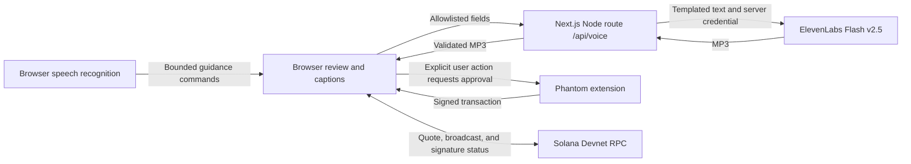

# Clearstep

Clearstep is a voice-guided transaction review app. It gives people time to understand the amount, recipient, network, and estimated fee of a SOL transfer before they decide whether to continue. It reads the details aloud with matching captions, explains the fee, and points to controls on request. If the amount or recipient changes, Clearstep clears the old acknowledgement so the user can review the new details.

The app opens in **Demo mode** with a simulated 0.05 SOL transfer. **Live wallet** mode can prepare a native SOL transfer on Solana Devnet using Phantom. See the [verification and submission checklist](DEMO_CHECKLIST.md) for the current evidence for each mode.

## Run locally

Use a patched Node.js LTS release, version 22.18 or newer, with npm. Run these commands from the directory containing `package.json`.

```bash
npm ci
npm run dev
```

Open [http://localhost:3000](http://localhost:3000) in current desktop Chrome. To enable audio, create the local configuration from the example if you do not already have one.

```bash
cp -n .env.example .env.local
```

| Server variable | Purpose |
| --- | --- |
| `ELEVENLABS_API_KEY` | Key with Text to Speech access and enough credits for the recording. |
| `ELEVENLABS_VOICE_ID` | ID of the ElevenLabs voice the server should use. |

Set the values in `.env.local` and restart the server. Keep the file out of source control and use the same variable names in the deployment's server environment. With either value missing, captions and visible guidance still work. The devnet RPC URL is fixed in the app and requires no RPC key or extra environment variable.

## Rehearse the demo

1. Open the app in **Demo mode**. Use **View address** to inspect the recipient and **Read details** to hear the amount, address fragments, network, and fee. The sample fee is labeled **Estimate**.
2. Select **I’ve reviewed these details**. Use **Explain fee**, then **Find Continue** or **Find Cancel**. The highlight fades and leaves the choice to you.
3. Select **0.5 SOL**. The old acknowledgement clears, Continue is replaced by the review acknowledgement, and the new details are read back. Use **Read details aloud** if you want to repeat them.
4. Choose **Cancel**, then **Reset demo**. Reset restores 0.05 SOL and clears the walkthrough state. **Text size** and **High contrast** remain available. The simulated walkthrough works without Phantom or microphone access.

Optional spoken commands include “Repeat the details,” “Explain the fee,” “Show me the recipient,” “Where is Continue?”, “Where is Cancel?”, and “Stop audio.” The same guidance is available through the on-screen controls. See the [timed demo script](DEMO_SCRIPT.md).

## Use Phantom on Solana Devnet

1. Open the Phantom desktop extension and select your avatar. Under **Settings → Developer Settings**, enable **Testnet Mode** and choose **Solana Devnet**. For a recording on localhost, leave **Auto-Confirm on localhost** off so the approval prompt is visible. [Phantom testnet setup](https://help.phantom.com/articles/view-testnets-in-phantom-5997313271699) · [Phantom developer settings](https://help.phantom.com/articles/28951369255699)
2. Fund a test wallet with enough devnet SOL for a 0.05 SOL transfer plus the fee. Copy a separate team-controlled Solana public address for the recipient. [Solana Devnet Faucet](https://faucet.solana.com/)
3. Click **Connect Phantom** in Clearstep. Enter the recipient, choose **0.05 SOL**, wait for the fee estimate, and acknowledge the review. Click **Review in Phantom**. Compare the amount and recipient in the approval screen. Reject the request for a dry run.
4. For a team-approved test transfer, approve in Phantom and wait for **Confirmed on Solana Devnet**. Open **View on Explorer** and verify the status, amount, recipient, and `cluster=devnet` on the link. If confirmation is uncertain, use **Recheck status** with the existing signature before trying another transfer.

## Technology and architecture

| Layer | Implementation |
| --- | --- |
| Frontend | Next.js 16 App Router, React 19, TypeScript, and CSS. [Transaction review](app/page.tsx) |
| Voice input | Browser Web Speech API in English, with deterministic command matching and visible button equivalents. [Voice intents](lib/voice-intents.ts) |
| Speech output | A Next.js Node.js route calls ElevenLabs Text to Speech with Flash v2.5 (`eleven_flash_v2_5`) and returns MP3. The browser and server share the templates used for captions and narration. [Voice route](app/api/voice/route.ts) · [Shared templates](lib/voice-copy.ts) |
| Wallet and chain | Phantom’s injected Solana provider supplies the signature. `@solana/web3.js` and Solana’s Base58 codec prepare the transfer, validate the signed bytes, and work with the public devnet RPC. [Devnet integration](lib/solana-devnet.ts) |



In live mode the browser verifies the RPC's devnet genesis hash, prepares a version-0 System Program transfer with a recent blockhash, and estimates the fee against that message. Approval uses Phantom's sign-only API. Clearstep verifies the signature and exact reviewed message before broadcasting to the pinned devnet RPC with preflight enabled. It displays confirmation only when the chain reports it. The latest signature and expiry are kept in same-tab session storage for status recovery. [Phantom signing API](https://docs.phantom.com/solana/sending-a-transaction) · [Solana RPC documentation](https://solana.com/docs/rpc)

The browser sends the voice route the amount, a fee description, and the first and last recipient characters when available. The route forwards only the selected template text to ElevenLabs. Browser speech recognition uses the browser's own service and is separate from ElevenLabs synthesis. Provider retention settings apply to the text sent for synthesis. [ElevenLabs speech endpoint](https://elevenlabs.io/docs/api-reference/text-to-speech/convert)

## Production and hosting

To check the current checkout in production mode locally, stop any dev server on the same port and run these commands.

```bash
npm ci
npm run build
npm run start
```

**Public release gate:** This checkout pins Next.js 16.2.1, which falls within published affected version ranges. Upgrade to a current patched stable release and rerun the build and integration checks before exposing an instance. A passing build of the existing lockfile verifies compilation only. [Next.js security release](https://vercel.com/changelog/next-js-may-2026-security-release) · [Next.js releases](https://github.com/vercel/next.js/releases)

After that gate passes, use a Next.js-capable host or run the existing Node server behind HTTPS. Select the repository directory with `package.json`, use `npm ci` and `npm run build`, and set the two server environment variables above. For a self-hosted Node server, run `npm run start` and configure the reverse proxy for the selected port. The dynamic `POST /api/voice` route requires a Node runtime. A static export would omit the voice backend. [Next.js deployment guide](https://nextjs.org/docs/app/getting-started/deploying)

Allow at least 25 seconds of server execution time for the request-body and upstream deadlines. The route limits JSON to 1 KiB and MP3 to 1 MiB, with up to 48 synthesis attempts per minute and two concurrent calls per Node instance. Add platform or proxy rate limiting for `/api/voice` and use a TTS-scoped key with a credit cap. Verify the audio, headers, and app access on the real judge URL. [Vercel Firewall rate limiting](https://vercel.com/docs/vercel-firewall/vercel-waf/rate-limiting) · [ElevenLabs API key restrictions](https://elevenlabs.io/docs/api-reference/authentication)

## Scope and troubleshooting

- The live scope is a single native SOL transfer on devnet, with two amount presets and the Phantom desktop extension. Mainnet, SPL tokens, other wallets or chains, custom programs, transaction history, and speech speed controls are outside the current implementation.
- Voice explains fields and highlights controls. A user approves signing in Phantom. A syntactically valid address is simply a destination, and the review provides no recipient identity or risk assessment.
- The live path requires a top-level HTTPS or localhost page, modern browser APIs including Web Crypto Ed25519, an extension with sign-only support, and access to the shared devnet RPC. Speech recognition and autoplay depend on browser settings. [Phantom provider detection](https://docs.phantom.com/solana/detecting-the-provider)

| Symptom | What to check |
| --- | --- |
| Phantom missing or approval unavailable | Open the app directly in current Chrome, enable and unlock Phantom, verify Devnet mode, and retry. Use **Demo mode** if the extension or signing path is unavailable. |
| Fee unavailable or insufficient balance | Confirm the recipient and devnet balance. Allow enough SOL for both the amount and fee, then choose **Refresh devnet details**. A changed quote or expired blockhash requires a fresh review. |
| Status unknown | Use **Recheck status** and inspect the existing signature in the devnet Explorer. Clearstep blocks another live submission while the outcome is unresolved. |
| Captions appear but there is no audio | If **Play audio** is shown, click it. Otherwise verify the key, voice ID, TTS access, credits, and server egress. Restart after changing environment values and use **Retry audio**. |
| Voice commands unavailable | Check mic permissions on the presentation browser, or use **Explain fee**, **Show recipient**, and the **Find** buttons. |

## Run verification

```bash
npx tsc --noEmit --incremental false
node --test tests/devnet.test.mjs tests/voice-route.test.mjs tests/voice.test.mjs
npm run build
```

For the optional browser suite, set `CLEARSTEP_CHROME_PATH` to a local Chrome or Chromium executable after building, then run `node --test tests/demo-browser.test.mjs`. The suite starts a localhost server and uses a temporary browser profile with mocked Phantom, Solana RPC, speech recognition, and audio. There is no configured lint command.

## Submission files

- [Product description and Devpost answers](PRODUCT.md)
- [Timed demo script](DEMO_SCRIPT.md)
- [Submission checklist and feature audit](DEMO_CHECKLIST.md)
- [Project spec](PROJECT_SPEC.md) and [implementation plan](IMPLEMENTATION.md)
